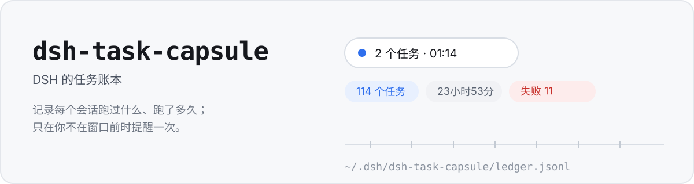
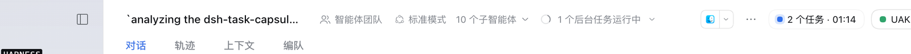
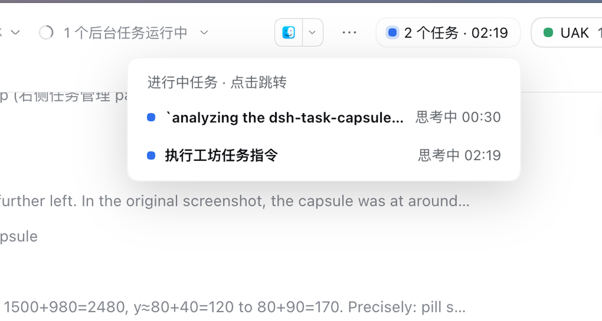
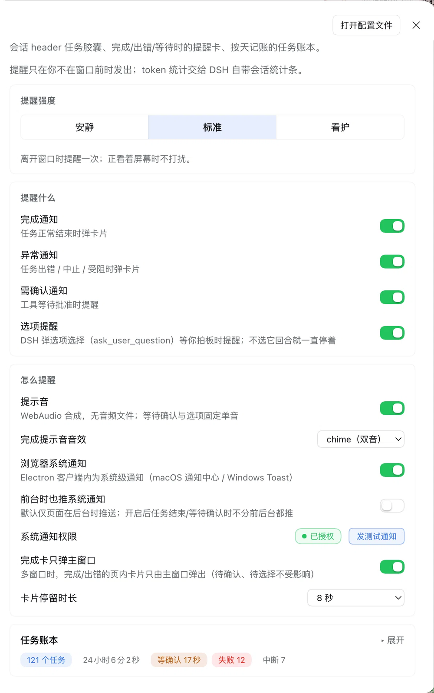
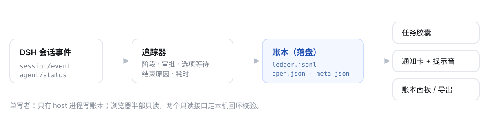

**dsh-task-capsule** — a ledger for your DeepSeek Harness sessions: what each one ran, how long it took, whether it failed or was interrupted, and how much time went into waiting for approvals. One alert when you step away with something finished or waiting.

Zero runtime dependencies · MIT · [Roadmap](ROADMAP.md) · [Changelog](CHANGELOG.md) · [Compatibility](docs/COMPATIBILITY.md)

---

## 它解决什么

你同时开着几个会话跑长任务，切去写代码或者开会。回来第一个问题永远是：**刚才那个跑完没有？跑了多久？**

DSH 原生会告诉你「这个会话现在是什么状态」，但不会留下记录，也不会在你离开时叫你。这个插件补的是这两件事——**一份可回读的账本**，加**一次打扰**。

| 场景 | 之前 | 现在 |
| --- | --- | --- |
| 切走 20 分钟回来 | 不知道跑完没，可能白等或重复发起 | 胶囊显示「N 个任务 · 耗时」，点开看明细 |
| 离开时任务结束 | 完全静默，回来零痕迹 | 回来看到一张聚合卡「离开期间 3 个任务结束」，一次提示音 |
| 工具等你批准 / 选项等你拍板 | 会话就那么停着 | 页内卡 + 提示音 +（可选）系统通知 |
| 想知道今天跑了什么 | 只能翻聊天记录 | 账本面板：按天汇总、逐条详情、导出 CSV/JSONL |

## 长什么样

| 任务胶囊 | 任务下拉 |
| --- | --- |
|  |  |



<sub>设置页：提醒强度 / 提醒什么 / 怎么提醒 三组开关 + 账本卡片。账本默认收起，收起态也带着今日摘要——任务数、总耗时、等你确认、失败、中断。</sub>

## 它跟「又一个提醒器」的区别

- **账本优先，提醒其次**：收尾记录先落盘（`ledger.jsonl`），再谈弹不弹。提醒链路受浏览器节流与焦点语义支配、修不好；记录链路不可靠只是"没写盘"。
- **默认安静**：页面可见且有焦点、记录在 10 秒内结束时，只记未读，不弹卡不响铃。真正打断你的只有两件事——你不在窗口前，或者有东西在等你操作。
- **失败与中断分开算**：宿主重启/崩溃补出来的记录标「中断恢复」，用户主动关掉会话标「已关闭」，都不进「没跑成」。否则重启几次，汇总就没意义了。
- **审批和选项等待都记账**：`approvalWaitMs` 是原生不给的数据——今天有多少时间花在等批准上，账本说得清。

## 怎么工作



宿主半部订阅会话事件，维护每个会话的阶段、审批、选项等待与结束原因；收尾时先写账本再广播。浏览器半部只读：两个接口过了本机回环 + 同源校验，所有展示都从同一份快照派生。

## 安装

克隆之后走面板装，面板会自己登记 bundle：

```sh
git clone https://github.com/wzn16/dsh-task-capsule.git
```

然后在 **插件 → 添加插件** 里选这个目录，**完全退出并重启 DSH Desktop**（刷新浏览器不够）。

<details>
<summary>CLI 装法 / 手动兜底</summary>

```sh
cd ~/工作/code/dsh-task-capsule && PLUGIN_DIR="$(pwd)"   # 换成你的克隆路径
cd ~/.dsh/profiles/desktop                              # 你的 profile 名见 ls ~/.dsh/profiles/
pnpm add "link:$PLUGIN_DIR"                             # 等价：dsh plugin --profile desktop add "link:$PLUGIN_DIR"
grep -n '"dsh-task-capsule"' package.json               # 依赖与 dsh.profile.bundles 两处都要有
```

**`pnpm add` 不会替你写 `dsh.profile.bundles`**，缺的那行得手补；面板安装才会自动登记。
</details>

**装完确认**（三条都要满足）：① 设置页出现「任务胶囊」分区；② 会话 header 右侧出现任务胶囊；③ 应用日志出现 `[dsh-task-capsule] host half loaded; features: runstate, notify`。

**兼容性**：实测版本、依赖面与升级后自查命令见 [docs/COMPATIBILITY.md](docs/COMPATIBILITY.md)。宿主 API 有过漂移（settings 门面拒写、slot 名变更），升级 DSH 后请重跑自查；插件加载失败会在日志里明确报出缺哪个服务。

## 配置

设置页分四组：提醒强度（安静 / 标准 / 看护三档预设）、提醒什么、怎么提醒、任务账本。切档位会覆盖单项设置，单项也可以单独调。

| 配置 | 默认 | 说明 |
| --- | --- | --- |
| 提醒强度 | 标准 | 安静：只提醒被卡住的；标准：离开窗口时提醒一次；看护：全提醒、系统通知常开、卡片常驻 |
| 完成通知 | 开 | 任务正常结束弹卡；正看着屏幕时只记未读 |
| 异常通知 | 开 | 任务出错 / 中止 / 受阻时弹卡 |
| 需确认通知 | 开 | 工具等待批准时提醒 |
| 选项提醒 | 开 | DSH 弹选项选择（`ask_user_question`）等你拍板时提醒 |
| 提示音 | 开 | WebAudio 合成，无音频文件；等待确认与选项固定单音 |
| 完成提示音音效 | chime | chime（双音）/ ding（单音） |
| 浏览器系统通知 | 关 | Electron 内为系统级通知（macOS 通知中心 / Windows Toast） |
| 前台时也推系统通知 | 关 | 默认仅后台推送；开启后不分前后台 |
| 完成卡只弹主窗口 | 关 | 多窗口时完成/出错卡只由主窗口弹出（待确认、待选择不受影响） |
| 卡片停留时长 | 8 秒 | 5 / 8 / 15 / 30 秒与「常驻」；配置值是毫秒，0 = 常驻 |

## 数据落盘

账本目录 `~/.dsh/dsh-task-capsule/`（`DSH_HOME` 覆盖时跟着走），文件权限 `0600`：

| 文件 | 内容 | 写入方式 |
| --- | --- | --- |
| `ledger.jsonl` | 已结束任务，一行一条，1000 条 / 2MB 封顶后轮转 | 追加写 |
| `ledger.1.jsonl` | 轮转后的上一代 | 轮转时改名 |
| `open.json` | 运行中任务快照（5 秒节流） | 原子重写 |
| `meta.json` | 已读位与计数 | 原子重写 |

崩溃或强杀后重启，`open.json` 里挂着的任务会补成一条「中断」记录，结束时间取最后活动时刻，不伪造。删掉整个目录即回到初始状态。字段定义见 [docs/FIELDS.md](docs/FIELDS.md)。

## 插件间只读查询

```sh
# 区间查询：当页记录 + 区间汇总
curl -s -X POST http://127.0.0.1:<port>/dsh-task-capsule/ledger/query \
  -H 'content-type: application/json' -d '{"since":0,"limit":50,"offset":0}'

# 区间导出
curl -s -X POST http://127.0.0.1:<port>/dsh-task-capsule/ledger/export \
  -H 'content-type: application/json' -d '{"since":0}'
```

只接受本机回环 + 同源请求，只读、无副作用。字段字典与兼容承诺见 [docs/FIELDS.md](docs/FIELDS.md)。

## 已知限制

- **只在 DSH 页面打开时有效**：插件跑在渲染进程里，不是后台守护进程。
- **后台可能迟到**：页面隐藏时浏览器节流定时器，提醒最长延迟到分钟级；记录不丢。
- **多窗口**：提示音与系统通知只由一个窗口发出（本地租约选主），页内卡片默认各窗口各一份，可开「完成卡只弹主窗口」。
- **只接受本机回环访问**：用局域网 IP、手机或 tailscale 打开 Web GUI 时，胶囊与通知失效。
- **下拉只显示最近 20 条**：账本保留 1000 条 / 2MB，更早的在面板里翻或直接导文件。
- **配置不在 DSH 设置里**：落盘在 `~/.dsh/dsh-task-capsule.notify.json`，删掉即回默认。

## 版本与更新

- 版本以 `package.json` 为准，逐版改动见 [CHANGELOG](CHANGELOG.md)，发布说明见 [Releases](https://github.com/wzn16/dsh-task-capsule/releases)。
- 📝 中文介绍与设计思路：[掘金 · 我给 AI 编码工具写了本「任务账本」](https://juejin.cn/spost/7699013116714156067)
- 更新：`cd 你的克隆目录 && git pull` → 完全退出并重启 DSH Desktop。`link:` 安装不会自动跟版本。
- 出问题按 [docs/ROLLBACK.md](docs/ROLLBACK.md) 取证与回滚。

> **1.x 更新策略**：1.0 之后不冻结功能，1.x 接功能与改进（含社区 PR），破坏性变更留给 2.0。

## 界面语言

默认中文，跟随 DSH 客户端语言自动切换：`zh` / `en`。语言由可选的 `locale` 服务决定，服务缺失、语言未知或词条缺失时一律回落到中文——旧版 DSH 上行为与之前完全一致。

词条源码是 `locale/<lang>.json`（键集三份必须一致），`client.js` 里 `/* locale-messages:start */` 与 `end` 之间那段是生成出来的，别手改：

```sh
node scripts/gen-locale.mjs            # locale/*.json → client.js
node scripts/gen-locale.mjs --check    # 只校验是否同步（提交前跑）
```

加一门语言：复制 `locale/en.json` 改名、翻完，在 `scripts/gen-locale.mjs` 的 `LOCALES` 里加一行，再跑一次上面第一条。运行时没有构建链，内联的就是字典本身。

本仓库只内置 `zh` / `en`：`locale` 的可用语言由 DSH 客户端目录决定，插件不自行 `addLanguage()` 注册新语言，所以再做语言包请走独立插件（`addLanguage({ id, label, fallback: 'en' })` + 自带字典）。

## 开发

```sh
npm run check                                                              # 前四条串起来跑一遍
node scripts/check-host-symbols.mjs                                        # 升级 DSH 后先跑：宿主里 7 个平台符号还在不在
node scripts/smoke.mjs                                                     # 模块装配 + 标识/平台符号一致
node --test scripts/unit.test.mjs                                          # 15 条纯函数与降级路径
node scripts/gen-locale.mjs --check                                        # locale/*.json 与 client.js 是否同步
DSH_WEB_BASE=http://127.0.0.1:<port> bash scripts/security-regression.sh   # 路由信任门 4 条断言
```

结构：`index.js`（Host 入口）、`src/task-track.js`（追踪器）、`src/ledger.js`（账本）、`src/platform.js`（平台符号）、`features/*`（只读路由）、`client.js`（浏览器半部，手写 bundle 无构建链）。

## License

MIT
