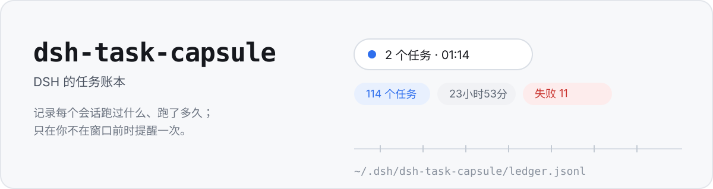
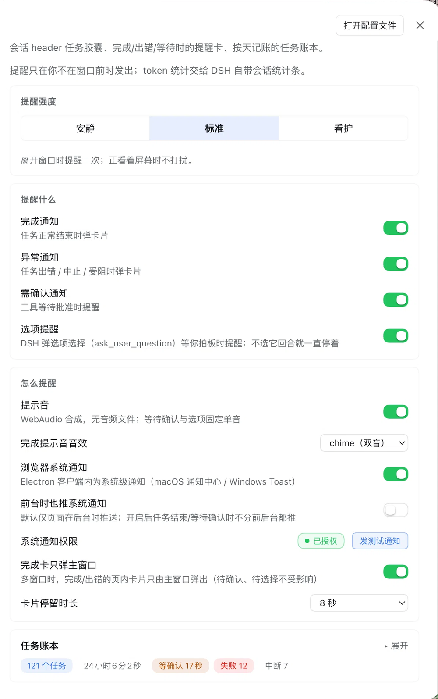
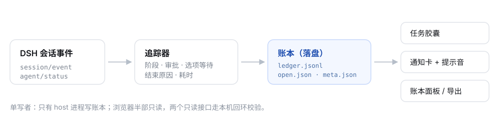

---

## 它解决什么

你同时开着几个会话跑长任务，切去写代码或者开会。回来第一个问题永远是：**刚才那个跑完没有？跑了多久？**

DSH 原生会告诉你「这个会话现在是什么状态」，但不会留下记录，也不会在你离开时叫你。这个插件补的是这两件事——**一份可回读的账本**，加**一次打扰**。

| 场景 | 之前 | 现在 |
| --- | --- | --- |
| 切走 20 分钟回来 | 不知道跑完没，可能白等或重复发起 | 胶囊显示「N 个任务 · 耗时」，点开看明细 |
| 离开时任务结束 | 完全静默，回来零痕迹 | 回来看到一张聚合卡「离开期间 3 个任务结束」，一次提示音 |
| 工具等你批准 / 选项等你拍板 | 会话就那么停着 | 页内卡 + 提示音 +（可选）系统通知 |
| 想知道今天跑了什么 | 只能翻聊天记录 | 账本面板：按天汇总、逐条详情、导出 CSV/JSONL |

## 长什么样

| 任务胶囊 | 任务下拉 |
| --- | --- |
|  |  |



<sub>设置页：提醒强度 / 提醒什么 / 怎么提醒 三组开关 + 账本卡片。账本默认收起，收起态也带着今日摘要——任务数、总耗时、等你确认、失败、中断。</sub>

## 它跟「又一个提醒器」的区别

- **账本优先，提醒其次**：收尾记录先落盘（`ledger.jsonl`），再谈弹不弹。提醒链路受浏览器节流与焦点语义支配、修不好；记录链路不可靠只是"没写盘"。
- **默认安静**：页面可见且有焦点、记录在 10 秒内结束时，只记未读，不弹卡不响铃。真正打断你的只有两件事——你不在窗口前，或者有东西在等你操作。
- **失败与中断分开算**：宿主重启/崩溃补出来的记录标「中断恢复」，用户主动关掉会话标「已关闭」，都不进「没跑成」。否则重启几次，汇总就没意义了。
- **审批和选项等待都记账**：`approvalWaitMs` 是原生不给的数据——今天有多少时间花在等批准上，账本说得清。

## 怎么工作



宿主半部订阅会话事件，维护每个会话的阶段、审批、选项等待与结束原因；收尾时先写账本再广播。浏览器半部只读：两个接口过了本机回环 + 同源校验，所有展示都从同一份快照派生。

## 安装

```sh
# 1. 克隆（零运行时依赖，不需要 install），记住绝对路径
git clone https://github.com/wzn16/dsh-task-capsule.git
cd dsh-task-capsule && PLUGIN_DIR="$(pwd)" && echo "$PLUGIN_DIR"
#   这一步要在同一个 shell 里跑完；换了窗口就把 $PLUGIN_DIR 换成上面打印的路径

# 2. 看你自己的 profile 目录，别照抄
ls ~/.dsh/profiles/
#   桌面端通常是 desktop，浏览器端（dsh web）是 web

# 3. 链进 profile：把 desktop 换成第 2 步看到的目录名
cd ~/.dsh/profiles/desktop
pnpm add "link:$PLUGIN_DIR"
#   等价：dsh plugin --profile desktop add "link:$PLUGIN_DIR"

# 4. 确认两处都有 dsh-task-capsule；缺 dsh.profile.bundles 就手动补一行
grep -n '"dsh-task-capsule"' package.json

# 5. 完全退出并重启 DSH Desktop（刷新浏览器不够）
```

**装完确认**（三条都要满足）：① 设置页出现「任务胶囊」分区；② 会话 header 右侧出现任务胶囊；③ 应用日志出现 `[dsh-task-capsule] host half loaded; features: runstate, notify`。

**兼容性**：已在 DSH Desktop 0.2.1-rc.2（macOS，desktop profile）实测；浏览器 profile 理论同构但未实测。宿主 API 有过漂移（settings 门面拒写、slot 名变更），升级 DSH 后请重跑上面的确认三条。插件加载失败会在日志里明确报出缺哪个服务。

## 配置

设置页分四组：提醒强度（安静 / 标准 / 看护三档预设）、提醒什么、怎么提醒、任务账本。切档位会覆盖单项设置，单项也可以单独调。

| 配置 | 默认 | 说明 |
| --- | --- | --- |
| 提醒强度 | 标准 | 安静：只提醒被卡住的；标准：离开窗口时提醒一次；看护：全提醒、系统通知常开、卡片常驻 |
| 完成通知 | 开 | 任务正常结束弹卡；正看着屏幕时只记未读 |
| 异常通知 | 开 | 任务出错 / 中止 / 受阻时弹卡 |
| 需确认通知 | 开 | 工具等待批准时提醒 |
| 选项提醒 | 开 | DSH 弹选项选择（`ask_user_question`）等你拍板时提醒 |
| 提示音 | 开 | WebAudio 合成，无音频文件；等待确认与选项固定单音 |
| 完成提示音音效 | chime | chime（双音）/ ding（单音） |
| 浏览器系统通知 | 关 | Electron 内为系统级通知（macOS 通知中心 / Windows Toast） |
| 前台时也推系统通知 | 关 | 默认仅后台推送；开启后不分前后台 |
| 完成卡只弹主窗口 | 关 | 多窗口时完成/出错卡只由主窗口弹出（待确认、待选择不受影响） |
| 卡片停留时长 | 8 秒 | 5 / 8 / 15 / 30 秒与「常驻」；配置值是毫秒，0 = 常驻 |

## 数据落盘

账本目录 `~/.dsh/dsh-task-capsule/`（`DSH_HOME` 覆盖时跟着走），文件权限 `0600`：

| 文件 | 内容 | 写入方式 |
| --- | --- | --- |
| `ledger.jsonl` | 已结束任务，一行一条，1000 条 / 2MB 封顶后轮转 | 追加写 |
| `ledger.1.jsonl` | 轮转后的上一代 | 轮转时改名 |
| `open.json` | 运行中任务快照（5 秒节流） | 原子重写 |
| `meta.json` | 已读位与计数 | 原子重写 |

崩溃或强杀后重启，`open.json` 里挂着的任务会补成一条「中断」记录，结束时间取最后活动时刻，不伪造。删掉整个目录即回到初始状态。字段定义见 [docs/FIELDS.md](docs/FIELDS.md)。

## 插件间只读查询

```sh
# 区间查询：当页记录 + 区间汇总
curl -s -X POST http://127.0.0.1:<port>/dsh-task-capsule/ledger/query \
  -H 'content-type: application/json' -d '{"since":0,"limit":50,"offset":0}'

# 区间导出
curl -s -X POST http://127.0.0.1:<port>/dsh-task-capsule/ledger/export \
  -H 'content-type: application/json' -d '{"since":0}'
```

只接受本机回环 + 同源请求，只读、无副作用。字段字典与兼容承诺见 [docs/FIELDS.md](docs/FIELDS.md)。

## 已知限制

- **只在 DSH 页面打开时有效**：插件跑在渲染进程里，不是后台守护进程。
- **后台可能迟到**：页面隐藏时浏览器节流定时器，提醒最长延迟到分钟级；记录不丢。
- **多窗口**：提示音与系统通知只由一个窗口发出（本地租约选主），页内卡片默认各窗口各一份，可开「完成卡只弹主窗口」。
- **只接受本机回环访问**：用局域网 IP、手机或 tailscale 打开 Web GUI 时，胶囊与通知失效。
- **下拉只显示最近 20 条**：账本保留 1000 条 / 2MB，更早的在面板里翻或直接导文件。
- **配置不在 DSH 设置里**：落盘在 `~/.dsh/dsh-task-capsule.notify.json`，删掉即回默认。

## 版本与更新

- 版本以 `package.json` 为准，改动见 [Releases](https://github.com/wzn16/dsh-task-capsule/releases)。
- 更新：`cd 你的克隆目录 && git pull` → 完全退出并重启 DSH Desktop。`link:` 安装不会自动跟版本。
- 出问题按 [docs/ROLLBACK.md](docs/ROLLBACK.md) 取证与回滚。

> **1.0 冻结**：功能到此为止，1.x 只修 bug、不新增功能。

## 开发

```sh
node scripts/smoke.mjs                                                     # 模块装配 + 标识/平台符号一致
node --test scripts/unit.test.mjs                                          # 14 条纯函数与降级路径
DSH_WEB_BASE=http://127.0.0.1:<port> bash scripts/security-regression.sh   # 路由信任门 4 条断言
```

结构：`index.js`（Host 入口）、`src/task-track.js`（追踪器）、`src/ledger.js`（账本）、`src/platform.js`（平台符号）、`features/*`（只读路由）、`client.js`（浏览器半部，手写 bundle 无构建链）。

## License

MIT
