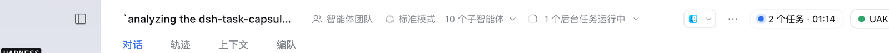
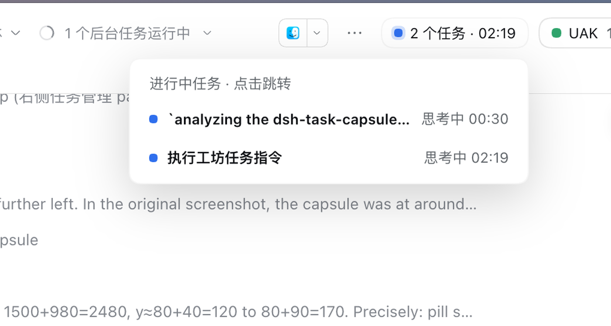
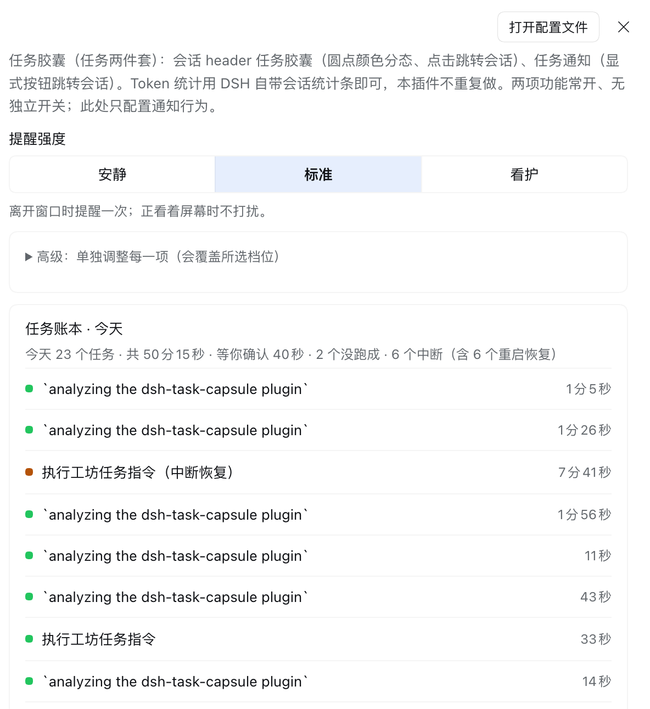

# dsh-task-capsule

DSH 的任务账本：把「跑过什么、跑了多久」记下来，并且只在你不在窗口前时提醒一次。

- **任务胶囊**：会话 header 常驻运行任务胶囊，圆点颜色分态（运行中 / 等待确认 / 已结束 / 出错），耗时每秒走、待确认的会话排在最前，点击跳转对应会话
- **任务通知卡**：任务完成 / 出错 / 等待用户确认时弹出页内通知卡，显式按钮跳转对应会话；支持提示音（WebAudio 合成，无音频文件）与系统通知（可选）
- **账本与未读**：收尾记录落盘到 `~/.dsh/dsh-task-capsule/ledger.jsonl`，重启仍在；胶囊空闲态显示未读数，展开下拉即已读
- **提醒闸门**：正盯着屏幕时发生的完成不打扰（只记未读）；离开期间攒下的完成合并成一张卡，一次响一声
- **账本面板**：设置区里看今天的汇总（任务数 / 总耗时 / 等你确认的时长 / 失败数）、逐条记录、展开详情、复制一段摘要







从 dsh-dock 最常用的功能提取精简而成；零运行时依赖，token 统计交给 DSH 自带会话统计条，不重复做。

## 兼容性

- 已在 DSH Desktop 0.2.1-rc.2（macOS，desktop profile）实测可用。其他版本没验证过：宿主 API 有过漂移（settings 门面拒写、slot 名变更），升级 DSH 后请重跑下面的「装完确认」。
- 浏览器端（`~/.dsh/profiles/web`）理论同构可用，但本仓库未在该 profile 实测。
- 本机工具链为 Node 22.23.2 + pnpm 12.3.4，profile 侧依赖就是用这套 pnpm 装的。

装完确认（三条都要满足）：① 设置页出现「任务胶囊」分区；② 会话 header 右侧出现任务胶囊；③ 应用日志里出现 `[dsh-task-capsule] host half loaded; features: runstate, notify`（桌面端看应用日志，没有终端可看）。

## 版本与更新

- 当前版本以 `package.json` 的 `version` 为准，各版本改动见 GitHub Releases。
- 更新：`cd 你的克隆目录 && git pull && pnpm install`（依赖没变可跳过 install）→ 完全退出并重启 DSH Desktop。`link:` 安装不会自动跟版本，必须手动拉。

## 安装

```sh
# 1. 克隆（零运行时依赖，不需要 install），顺手记住绝对路径
git clone https://github.com/wzn16/dsh-task-capsule.git
cd dsh-task-capsule && PLUGIN_DIR="$(pwd)" && echo "$PLUGIN_DIR"
#   这一步要在同一个 shell 里跑完；中途换了窗口，就把 $PLUGIN_DIR 换成上面打印的绝对路径

# 2. 看你自己的 profile 目录，别照抄路径
ls ~/.dsh/profiles/
#   桌面端通常是 desktop，浏览器端（dsh web）是 web

# 3. 链进 profile：把 desktop 换成第 2 步看到的目录名
cd ~/.dsh/profiles/desktop
pnpm add "link:$PLUGIN_DIR"
#   等价写法：dsh plugin --profile desktop add "link:$PLUGIN_DIR"

# 4. 确认两处都有 dsh-task-capsule；缺 dsh.profile.bundles 就手动补一行
grep -n '"dsh-task-capsule"' package.json

# 5. 完全退出并重启 DSH Desktop（刷新浏览器不够）
```

## 配置

打开「系统通知」开关时会弹出系统授权弹窗（拒绝也不影响页内通知卡）。通知行为在插件设置区调整：

| 配置 | 默认 | 说明 |
| --- | --- | --- |
| 提醒强度 | 标准 | 三档预设：安静 / 标准 / 看护，切换会覆盖下面的单项（也可以展开「高级」单独调） |
| 完成通知 | 开 | 任务正常结束弹卡；正看着屏幕时只记未读 |
| 异常通知 | 开 | 任务出错 / 中止 / 受阻时弹卡 |
| 需确认通知 | 开 | 工具等待批准时弹卡（approval/asked） |
| 卡片停留时长 | 8 秒 | 设置页给 5 / 8 / 15 / 30 秒与「常驻」五档；配置值本身是毫秒，0 = 常驻 |
| 浏览器系统通知 | 关 | 系统级通知（DSH Desktop 客户端内为 macOS 通知中心 / Windows Toast；浏览器打开时为浏览器通知） |
| 前台时也推系统通知 | 关 | 默认仅页面在后台时推送；开启后任务结束 / 等待确认时不分前后台都推 |
| 提示音 | 开 | WebAudio 合成，无音频文件；等待确认提醒固定单音，完成音色见下一行 |
| 完成提示音音效 | chime | 完成音色：chime（双音）/ ding（单音）；异常音固定为双低音 |

## 系统通知说明

- 设置区会显示当前系统通知授权状态（已授权 / 未请求 / 已被拒绝）；授权被拒时按提示前往 系统设置 → 通知 → DSH Desktop（Windows：设置 → 系统 → 通知）手动允许，改完如未生效重启 DSH。
- 权限状态行与测试按钮常显，无需先打开「系统通知」开关：未授权时点「请求授权并测试」会弹出系统授权弹窗，允许后自动发送测试通知；已授权时点「发测试通知」直接验证链路。
- tag 去重（同类通知合并）由 Electron 实现，只在 Windows / Linux 生效；macOS 上每条通知独立展示。

## 数据落盘

账本目录 `~/.dsh/dsh-task-capsule/`（`DSH_HOME` 覆盖时跟着走）：

| 文件 | 内容 | 写入方式 |
| --- | --- | --- |
| `ledger.jsonl` | 已结束任务，一行一条，保留 1000 条或 2MB | 追加写 |
| `ledger.1.jsonl` | 轮转后的上一代 | 轮转时改名 |
| `open.json` | 运行中任务快照，5 秒节流 | 原子重写 |
| `meta.json` | 已读位与计数 | 原子重写 |

崩溃或强杀后重启，`open.json` 里还挂着的任务会被补成一条「中断」记录，不会凭空消失。删掉整个目录即恢复初始状态。

## 已知限制

- **只在 DSH 页面打开时有效**：插件跑在渲染进程里，不是后台守护进程。窗口全关就没有提醒。
- **后台可能迟到**：页面隐藏时浏览器会节流定时器，提醒最长可能延迟到分钟级；记录不会丢，但可能晚到。
- **多窗口**：提示音与系统通知只由一个窗口发出（本地租约选主），但每个窗口的页内卡片仍各显示一份。
- **系统通知被拒绝不影响页内卡片与提示音**：两条通道独立。
- **只接受本机回环访问**：插件的两个接口只信任 `127.0.0.1` / `localhost` / `[::1]`，并同时校验 Host、Origin 与 Sec-Fetch-Site。用局域网 IP、手机或 tailscale 打开 Web GUI 时，胶囊与通知会失效。
- **页面刷新会重弹未处理的确认提醒**：确认类提醒每次加载重新比对，处理掉的不会再弹；完成 / 出错类不补弹历史。
- **下拉只显示最近 20 条**：账本本身保留 1000 条 / 2MB，但胶囊下拉只取最近 20 条（更早的还在文件里）。
- **通知卡同时最多 5 张**：并发任务多时最早的会被挤出去，可能漏看。
- **配置不在 DSH 设置里**：通知配置落盘在 `~/.dsh/dsh-task-capsule.notify.json`，删掉该文件或更换 `DSH_HOME` 就回默认值。

## 结构

- `index.js` — Host 半部入口：会话追踪实例、路由装配（v0.5 起不再注册 settings 命名空间）
- `src/host-core.js` — 常量、settings schema、HTTP 小工具
- `src/task-track.js` — 会话级任务追踪：阶段推导、等待确认（approvals）、会话标题与结束归档
- `src/ledger.js` — 账本：收尾记录追加写、open 快照、崩溃恢复、未读位
- `features/ledger/` — 账本查询路由（区间查询 + 汇总，只读）
- `features/runstate/` — 任务胶囊数据源（只读快照路由）
- `features/notify/` — 通知配置持久化 + 快照路由（页内卡片/提示音/系统通知在浏览器半部）
- `client.js` — Web 半部：胶囊渲染、通知卡、提示音、设置区
- `scripts/security-regression.sh` — 路由信任门回归（4 条断言）：`DSH_WEB_BASE=http://127.0.0.1:49539 bash scripts/security-regression.sh`

## License

MIT
